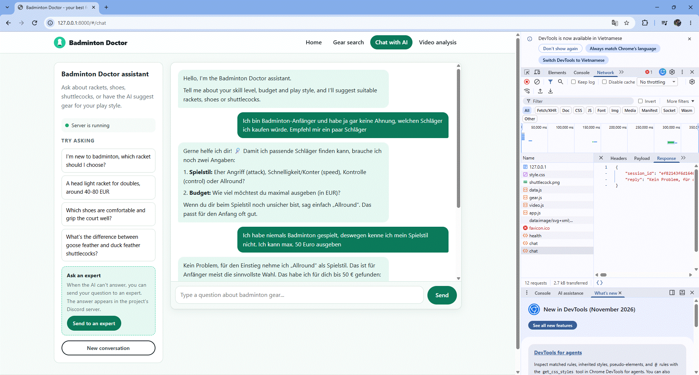
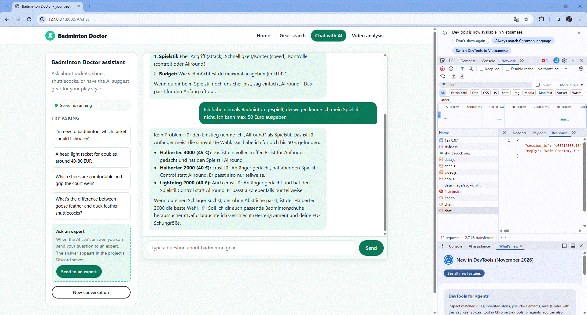

# Badminton Advisor

An LLM agent that recommends badminton rackets and shoes from a curated catalog and
answers equipment questions from a small knowledge base. The same tools are available
through a web chat, a REST API and an MCP server.





## Highlights

- **Tool-using agent** (Claude API): the model chooses among 5 tools (`recommend_racket`,
  `find_racket`, `recommend_shoes`, `find_shoe`, `search_knowledge`) and the server runs them.
- **RAG** over a knowledge base with a multilingual embedding model, so a Vietnamese or
  German question can retrieve an English passage.
- **MCP server** exposing the same tools to any MCP client (for example Claude Desktop).
- **Layered architecture** (domain / data / presentation) with one tool registry shared by
  the agent and the MCP server.
- **Safety nets:** a 712-case golden regression suite, 17 automated tests, and a 40-question
  agent evaluation (119/120 in the latest run, see [Agent evaluation](#agent-evaluation)).

**Status:** personal portfolio project; no real users yet. The catalog is small
(26 rackets, 5 shoes) and shuttles are planned. See the limits sections below.

## What it does

Players describe what they need ("I'm a beginner, attacking style, 100 euro") and get the 3
best options for the item they ask about.

- **Rackets:** level, play style, budget, balance, stiffness, weight class.
- **Shoes:** gender and EU size (hard filters), foot width and a preference for light shoes
  (soft ranking), optionally a maximum price.
- **Language:** the project is in English. The agent replies in the language the user writes
  in. The knowledge base (`data/raw/knowledge.csv`) is an English translation of Vietnamese
  shop-blog articles; `source_url` still points to the original pages.

## Architecture

The code follows a three-layer layout. Dependencies point inwards: the domain
knows nothing about databases, web frameworks or LLMs.

```
presentation  ──►  domain  ◄──  data
(FastAPI, agent,   (scoring,    (SQLite repos,
 MCP server,        use cases,   embeddings,
 tool registry)     Protocols)   pipelines)
```

```
src/badminton/
├── domain/          scoring rules, use cases, repository Protocols (pure Python)
├── data/            SQLite repositories, embedding index, cleaning/build pipeline
├── presentation/    tool registry, Claude agent, FastAPI app, MCP server
├── config.py        paths
└── container.py     composition root: wires repositories into use cases
```

- One tool registry (`presentation/tools.py`) feeds both the Claude agent and
  the MCP server, so the two cannot drift apart.
- The files directly under `src/` (`api.py`, `agent.py`, `mcp_server.py`, ...)
  are thin entry points, so the run commands below did not change.

## Setup

Requires Python 3.11+ and an Anthropic API key.

```powershell
git clone <https://github.com/viethung1601/badminton-advisor.git>
cd badminton-advisor
python -m venv .venv
.venv\Scripts\Activate.ps1
pip install -r requirements.txt
copy .env.example .env      # then put your ANTHROPIC_API_KEY into .env
```

`sentence-transformers` pulls in PyTorch, so the install is large (several GB).

### Build the local data (not committed)

`data/badminton.db` and `data/knowledge_emb.npy` are git-ignored and must be generated once:

```powershell
python src/build_db.py
python src/build_shoes_db.py
python src/knowledge.py build
```

The first embedding run downloads the embedding model from Hugging Face, so it needs internet and takes a while.
Whenever you edit `data/raw/knowledge.csv`, run `python src/knowledge.py build` again; search refuses to run on a stale index.

### Run

```powershell
uvicorn api:app --app-dir src
```

Open http://127.0.0.1:8000. The "Ask an expert" button also needs n8n running (see below); everything else works without it.

## Tests

```powershell
pip install pytest
python -m pytest tests -q          # unit + API tests (17)
python tests/test_golden.py        # 712-case regression check
```

- `tests/test_golden.py` runs the use cases with 712 input combinations and compares
  the output with `tests/golden/baseline.json`, which was recorded from the code
  *before* the layered refactor. It is a safety net: it proves behavior did not change,
  not that the old behavior was correct.
- Use-case tests run against fake repositories (no database, no API key); API tests
  replace the LLM call with a fake.
- If you change user-facing text on purpose, the golden test fails. Check that only
  the text changed. There is currently no script to regenerate the baseline.

## Limits of the racket recommender

- Content-based ranking (weighted Manhattan distance); no model is trained on data.
- The weights and the `min_score` threshold are set by the author from badminton knowledge and have not been validated with user feedback.
- Small dataset (26 rackets): some level × style × balance combinations are empty. In that case `status = "approximate"`.
- Many rackets can tie at 1.0; the order currently depends only on ascending price.

## Shoe recommender

Same two-step idea as the racket recommender, with different criteria:

- **Hard filter (SQL):** gender (`unisex` shoes are always included) and EU size (`size_min_eu <= size <= size_max_eu`), optionally price.
- **Soft ranking:** width match and lightness, each scored in [0, 1] and combined with weights (`W_WIDTH = 2`, `W_LIGHT = 1`).
- **Missing data:** if the user asks for a criterion that a shoe has no data for (for example weight), that shoe is not ranked. It is reported separately in `excluded_no_data` with the reason, so the bot can say so.
- Data pipeline: `data/raw/shoes.csv` -> `src/badminton/data/pipeline/clean_shoes.py` (checks column count per row, allowed values, numeric ranges, weight and reference size must come together) -> `data/processed/shoes_clean.csv` -> `src/badminton/data/pipeline/build_shoes_db.py`.
- Lookup by name: `find_shoe` returns the details of a specific pair (price, size range, weight, fit) or `not_found`.

### Limits of the shoe recommender

- Only 5 shoes so far: enough to prove the pipeline, not a catalog. Many gender × size combinations return few or no results.
- Manufacturers publish weight at different reference sizes, so weight comparison across brands is approximate.
- Lightness is min-max normalised among the shoes left after filtering, so it is relative: a single remaining shoe scores 1.0 even if it is not light.
- Shoes with several widths are stored as separate rows, so one model can fill several of the top 3 slots.
- Weights are author-chosen and not validated with user feedback.

## Agent evaluation

`python src/eval_agent.py [runs] [groups]` runs 40 questions in groups A-H. It checks
facts, not wording: whether the right tool was called, whether the arguments are valid,
and whether names and numbers in the answer appear in the tool result or in the question.

| Group | Topic | Questions × runs | Result |
|---|---|---|---|
| A | racket, complete info | 3 × 3 | 9/9 |
| B | racket, missing info | 3 × 3 | 9/9 |
| C | lookup by racket name | 3 × 3 | 9/9 |
| D | value ranges | 3 × 3 | 9/9 |
| E | budget too low | 4 × 3 | 12/12 |
| F | off-topic / out of scope | 3 × 3 | 8/9 |
| G | knowledge (RAG) | 8 × 3 | 24/24 |
| H | shoes | 13 × 3 | 39/39 |

**Latest run (all groups, current prompt, 3 runs per question):** 119/120.
The single failure is F3 ("How much do Yonex shoes cost?"): the bot summarized the price
range as "about €149 to €175", rounding €174.90 up. The numeric check compares numbers
exactly, so it flagged 175 as a value that is not in the tool result. The answer is
correct on reading, so this is a false alarm.

**Bugs found and fixed thanks to the test suite:**
- Low budget: the bot stated a budget level that is not in the data (~9% of runs, group E). Fixed in 3 rounds: a prompt instruction, then adding the lowest price to the tool result, then adding that racket's details (level, style, `is_exact`) so the bot no longer calls an approximate match "suitable".
- Lookup by name: the tool missed when the user typed the brand together with the name. Fixed the SQL query.

**Limits:**
- "Close enough" depends on `MIN_SCORE = 0.5` and author-chosen weights, not on an objective truth. With this threshold, a racket for a lower level can appear in the "closest" list of an advanced player.
- The script checks numbers and racket names, not the wording of descriptions. Wording errors (such as calling an approximate racket "suitable") only show up when reading real answers.

**Changes made because of the test suite:**
- Question F3 now expects `find_shoe`: it was written before the shoe tools existed.
- Group D2 ("medium or stiff") was flaky because the prompt never said what to do when the user accepts several values. Rule 14 in the system prompt fixed it (before: 0/2, after: 3/3).
- Knowledge retrieval: each passage is embedded with a short title; this fixed a passage that questions saying "beginner" could not find (see Embedding model evaluation).

## Embedding model evaluation

- Retrieval (`src/probe_eval.py`): 16/16 on a self-written set of 16 questions, including two Vietnamese questions against the English knowledge base.
- Each passage is embedded together with a short `title` column (for example "How a beginner should choose a racket, depending on arm strength"). Before adding the titles, a passage written about arm strength was missed by questions that say "beginner", because the word never appears in its text. Three extra questions written after the fix confirm it (ranks 1, 2 and 1).
- Limits: the question set is small and written by the author, so this shows the method works, not how well it generalizes. With `k = 3`, adding relevant passages can push other relevant ones out of the top 3.

## Ask an expert (n8n + Discord)

Users can send a question to a human expert from the web page. The question goes through n8n into a private Discord channel.

```
Browser ("Send to an expert" button)
  -> POST /ask-expert (FastAPI)
  -> n8n webhook /webhook/ask-expert
  -> HTTP Request -> Discord #expert-inbox
```

The expert answers publicly in `#hỏi-đáp` (the name of the public Q&A channel on the project's Discord server, "questions and answers" in Vietnamese) and tags the asker (this step is manual).

### Run n8n

```bash
docker run -d --name n8n -p 5678:5678 \
  -e GENERIC_TIMEZONE=Europe/Berlin \
  -e TZ=Europe/Berlin \
  -v n8n_data:/home/node/.n8n \
  docker.n8n.io/n8nio/n8n
```

The volume keeps workflows when the container is stopped or removed. Open http://localhost:5678.

### Import the workflow

1. In n8n: menu `...` -> **Import from File** -> `n8n/ask-expert.workflow.json`.
2. Open the **HTTP Request** node and replace `https://discord.com/api/webhooks/REDACTED` with the webhook URL of your own Discord channel.
3. **Save**, then switch the workflow to **Active**.

### Configuration

In `.env` (not committed):

```
N8N_WEBHOOK_URL=http://localhost:5678/webhook/ask-expert
```

FastAPI always calls `/webhook/` (the workflow must be Active), never `/webhook-test/`.

### Design decisions

- Sending a message out is triggered by a **user click**, not by an LLM tool, so prompt injection cannot make the system send messages on its own.
- The server accepts only a numeric Discord ID (17-20 digits) and builds the profile link itself; n8n receives only `question`, `discord_id` and `discord_url`.
- `allowed_mentions: {parse: []}` blocks @everyone/@role pings.
- Question text is not logged.

### Known limitations

- The Discord ID is typed by the user and **not verified** (verification would need Discord OAuth2).
- Chat sessions live in RAM: lost on restart, no multi-worker setup.
- No authentication; the 3-questions-per-session limit can be bypassed by creating a new session.
- The local n8n webhook is not authenticated.
- The expert's reply path back to the user is manual.

## MCP server

The same tools the agent uses are also exposed as an [MCP](https://modelcontextprotocol.io)
server, so any MCP client (for example Claude Desktop) can call the catalog and knowledge
base without the custom agent. Tools: `recommend_racket`, `find_racket`, `recommend_shoes`,
`find_shoe`, `search_knowledge`.

Run the server (stdio):

```powershell
python src/mcp_server.py
```

Test it with the bundled client:

```powershell
python src/test_mcp_client.py
```

### Use it in Claude Desktop

Add this to `claude_desktop_config.json` (Windows: `%APPDATA%\Claude\`), using absolute
paths to your virtual environment and the repository, then restart Claude Desktop:

```json
{
  "mcpServers": {
    "badminton-advisor": {
      "command": "C:\\path\\to\\badminton-advisor\\.venv\\Scripts\\python.exe",
      "args": ["C:\\path\\to\\badminton-advisor\\src\\mcp_server.py"]
    }
  }
}
```

The server talks over stdio, so nothing may print to stdout while it runs; logs go to stderr.

## Data sources

- **Product data** (`data/raw/rackets.csv`, `data/raw/shoes.csv`): compiled by hand from manufacturer and shop product pages.
- **Knowledge base** (`data/raw/knowledge.csv`): English translations and short summaries
  of articles from of articles from [xbsports.vn](https://xbsports.vn/blogs/news/) and
[shopvnb.com](https://shopvnb.com/). The `source_url` column ... The `source_url` column links each
  passage to the original page. The original content belongs to its authors; it is used
  here only for a non-commercial learning project, and the articles are not redistributed
  in full.
- If you are the owner of any of this content and want it removed or credited
  differently, please open an issue and it will be taken down.

## License

Code: MIT, see [LICENSE](LICENSE).
The data in `data/raw/` is not covered by this license; see [Data sources](#data-sources).